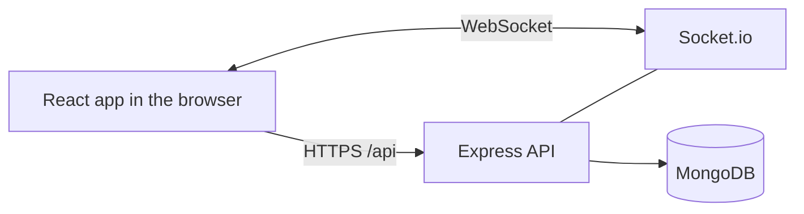
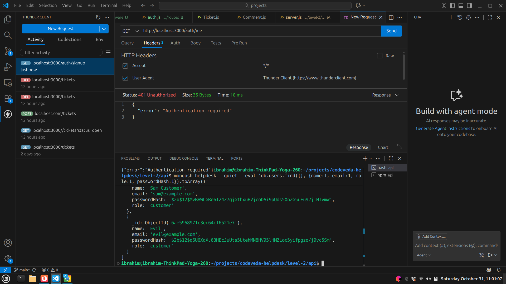
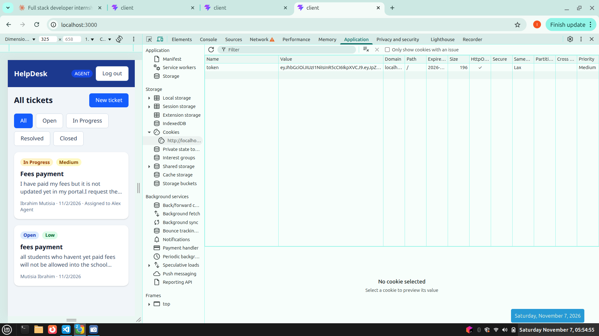
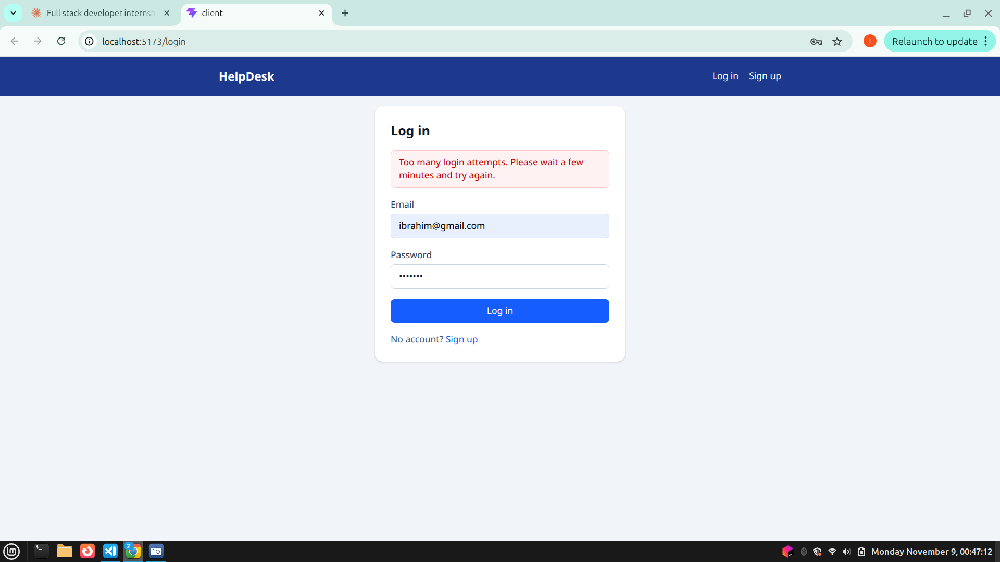
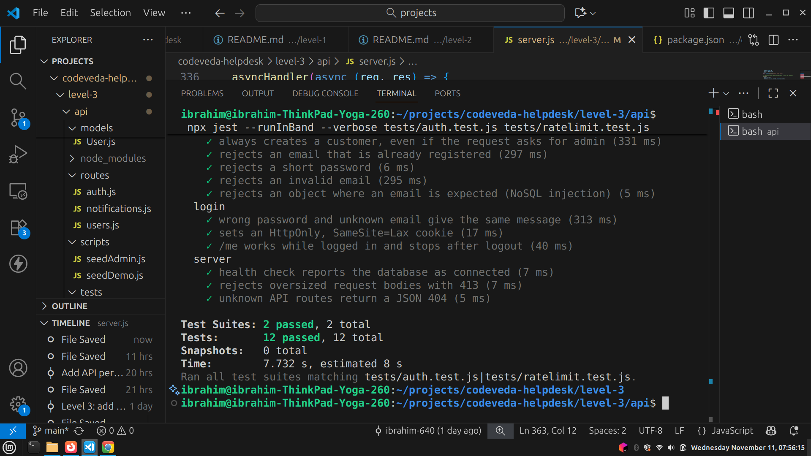
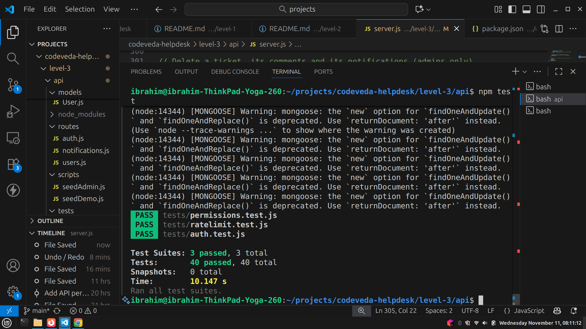
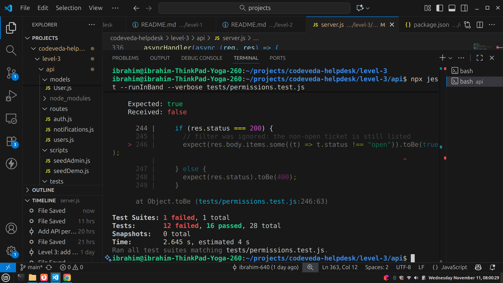
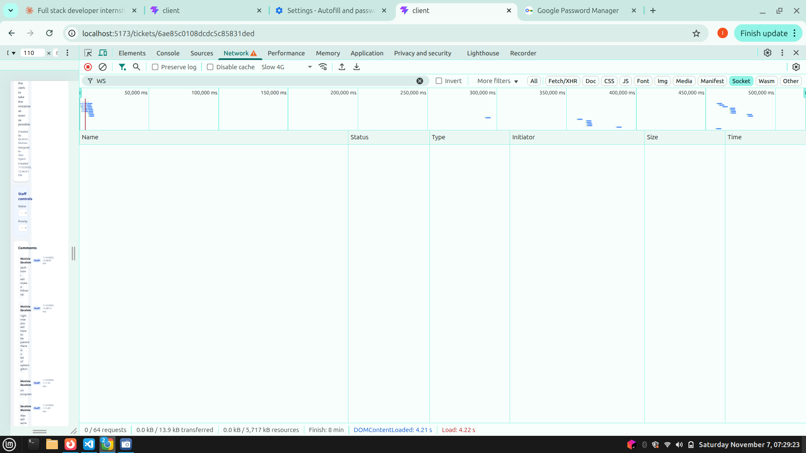

# HelpDesk: Support Ticket System


A role-based support ticket system with live notifications, built for the **Codveda Technology Full-Stack Development internship**. Customers raise tickets, agents work on them, and admins assign work, manage users and watch a statistics dashboard. The project grows level by level, and each level is a self-contained folder.

**Live demo:** https://codeveda-helpdesk.onrender.com
**Demo video:** [Watch on LinkedIn](LINKEDIN_VIDEO_URL)

> The demo runs on a free hosting plan, so the first visit after a quiet period can take up to a minute to wake up.
>Tickets titled "[Demo]" are generated sample data.
## Contents

- [Features](#features)
- [Try the live demo](#try-the-live-demo)
- [Levels](#levels)
- [Tech stack](#tech-stack)
- [Architecture](#architecture)
- [Permissions](#permissions)
- [API reference](#api-reference)
- [Database design](#database-design)
- [Security](#security)
- [Testing and CI](#testing-and-ci)
- [Screenshots](#screenshots)
- [Running locally](#running-locally)
- [Deployment](#deployment)
- [What I learned](#what-i-learned)
- [Known limitations](#known-limitations)
- [Future improvements](#future-improvements)
- [Repository layout](#repository-layout)

## Features

- **Customers** sign up, create tickets and comment on their own tickets
- **Agents** see every ticket and update status and priority
- **Admins** assign tickets to staff, delete tickets, manage user roles and see a statistics dashboard
- **Live updates:** new comments and status changes appear on an open ticket without a refresh, and a notification bell shows an unread count
- **Dashboard:** ticket counts by status and priority, tickets opened per day, average time to resolve, and workload per staff member
- **Pagination and filters** on the ticket list
- Responsive layout that works on phones

## Try the live demo

1. Open https://codeveda-helpdesk.onrender.com and **sign up**. New accounts are always customers.
2. Create a ticket and add a comment.
3. Agent and admin features (changing status, assigning, the Users page and the dashboard) need a staff account, so they are shown in the demo video. Staff accounts are created by an admin, since signup can never create one.

## Levels

| Level | Folder | Tasks completed | Status |
|---|---|---|---|
| 1 (Basic) | [`level-1`](./level-1) | Environment setup, REST API, vanilla JavaScript frontend | Done |
| 2 (Intermediate) | [`level-2`](./level-2) | Database integration, authentication and authorization, React frontend | Done |
| 3 (Advanced) | [`level-3`](./level-3) | Full-stack application (deployed), real-time features with WebSockets | Done |

Two tasks per level were required, so Level 1 includes all three, Level 2 includes all three, and Level 3 includes two (the GraphQL task was not attempted).

## Tech stack

| Layer | Technology |
|---|---|
| Backend | Node.js 20, Express |
| Database | MongoDB with Mongoose (validation, indexes, aggregation) |
| Authentication | bcrypt, JSON Web Tokens in `httpOnly` cookies |
| Real-time | Socket.io |
| Frontend | React (Vite), React Router, Tailwind CSS (plain HTML, CSS and JavaScript in Level 1) |
| Quality | Jest, supertest, ESLint, GitHub Actions |
| Hosting | Render (application), MongoDB Atlas (database) |

## Architecture



In production, Express serves both the API and the built React app from one address, so the browser sees a single origin. That keeps the `httpOnly` cookie and the WebSocket working with no CORS settings. In development, Vite proxies `/api` and `/socket.io` to Express.

Each socket is authenticated with the same cookie as the REST API and joins a private room for its user, so events only go to the people who should receive them. Notifications are also saved in MongoDB, so the unread count survives a refresh and anything missed while offline appears after reconnecting.

## Permissions

| Action | Customer | Agent | Admin |
|---|---|---|---|
| Create ticket | Yes | Yes | Yes |
| View tickets | Own only | All | All |
| Comment | On own tickets | Any | Any |
| Change status / priority | No | Yes | Yes |
| Assign ticket | No | No | Yes |
| Delete ticket | No | No | Yes |
| List users, change roles | No | No | Yes |
| Statistics dashboard | No | No | Yes |

These rules are enforced by the API on every request. Hiding a button in the interface is only a convenience.

## API reference

All routes live under `/api`.

| Method | Endpoint | Access |
|---|---|---|
| POST | `/auth/signup`, `/auth/login`, `/auth/logout` | Public (rate limited) |
| GET | `/auth/me` | Logged in |
| GET | `/tickets` (filters: `status`, `priority`, `page`, `limit`) | Logged in |
| POST | `/tickets` | Logged in |
| GET | `/tickets/:id` | Owner, agent, admin |
| PUT | `/tickets/:id` | Agent, admin (assigning: admin) |
| DELETE | `/tickets/:id` | Admin |
| GET, POST | `/tickets/:id/comments` | Owner, agent, admin |
| GET | `/notifications` | Logged in |
| POST | `/notifications/read-all` | Logged in |
| PATCH | `/notifications/:id/read` | Logged in |
| GET | `/users` | Admin |
| PATCH | `/users/:id/role` | Admin |
| GET | `/stats` | Admin |
| GET | `/health` | Public |

The ticket list returns `{ items, page, limit, total, pages }`, with `limit` defaulting to 10 and capped at 50.

**Socket.io events.** The client sends `ticket:join` and `ticket:leave`. The server sends `comment:new`, `ticket:updated` and `notification:new`.

## Database design

| Collection | Main fields |
|---|---|
| `users` | name, email (unique), passwordHash (never returned), role (`customer`, `agent`, `admin`) |
| `tickets` | title, description, priority, status, createdBy, assignedTo, resolvedAt, timestamps |
| `comments` | ticket, author, text, timestamps |
| `notifications` | user, ticket, type (`assigned`, `comment`, `status`), message, read |

- **Relationships:** tickets reference their creator and assignee, comments reference their ticket and author, and deleting a ticket also deletes its comments and notifications.
- **Indexes:** tickets on `status + createdAt`, `createdBy + createdAt` and `createdAt`; comments on `ticket + createdAt`; notifications on `user + createdAt` and `user + read`; a unique index on user emails.
- **Index tuning:** query plans were checked with `explain()`. A compound index with the equality field first and the sort field second lets MongoDB read only the matching entries, already in order.
- **Dashboard:** all statistics come from a single aggregation with `$facet`, so the page needs one database round trip.

## Security

- Passwords are hashed with bcrypt, and the hash is never returned by the API
- The JWT lives in an `httpOnly`, `SameSite=Lax` cookie (`Secure` in production), so page scripts cannot read it
- A user's role and account are reloaded from the database on every request, so a demotion or deletion takes effect immediately
- Signup always creates a customer, and the first admin is created by a seed script, so nobody can sign up as an admin
- Rate limiting: 10 failed logins per 15 minutes and 10 signups per hour per IP, plus a general cap on the API
- Input validation on every route, with query values checked as plain strings to block NoSQL injection
- Request bodies are capped at 10 KB, and pagination limits are validated
- Security headers via Helmet, gzip compression, and an origin check on WebSocket connections
- Customers get a 404, not a 403, for tickets they do not own, so ticket ids cannot be probed
- Login errors are identical for an unknown email and a wrong password
- Secrets live in environment variables and are never committed

## Testing and CI

**40 automated tests** (Jest and supertest) cover:

- The permission rules for each role, including cases where access must be refused
- Signup and login behaviour, cookie flags and logout
- Role changes and account deletion taking effect immediately
- Notifications reaching the right people and never the person who made the change
- Cascade deletes, pagination limits and filter injection
- The rate limiter, the request size limit and the health check

```bash
cd level-3/api
npm test
```

Tests run against a separate `helpdesk_test` database. The test helper refuses to run against any database whose name does not end in `_test`, so real data cannot be wiped by mistake.

**GitHub Actions** runs on every push. It runs the API tests against a MongoDB 7.0 service container, and lints and builds the React client.

## Screenshots

### Data and security

**Passwords are stored as bcrypt hashes, never in plain text**



**The session cookie is `HttpOnly`, so scripts on the page cannot read it**



**Repeated failed logins are blocked with a 429**



### Testing

**Authentication, server and rate-limit tests passing**



**The full suite passing**



**A test failing when a permission rule is deliberately broken, which shows the suite protects the rules**



### Deployment

**Deployment history on Render**



## Running locally

Requires Node.js 20+ and a running MongoDB (version 7 or newer).

```bash
# API
cd level-3/api
npm install
cp .env.example .env     # then fill in the values
npm run seed:admin       # creates the first admin from .env
npm run dev              # http://localhost:3000

# React client (second terminal)
cd level-3/client
npm install
npm run dev              # http://localhost:5173
```

`.env` values: `PORT`, `MONGODB_URI`, `JWT_SECRET`, `JWT_EXPIRES_IN`, `ADMIN_NAME`, `ADMIN_EMAIL`, `ADMIN_PASSWORD`. Generate a secret with:

```bash
node -e "console.log(require('crypto').randomBytes(48).toString('hex'))"
```

Optional: `node scripts/seedDemo.js` adds 30 sample tickets so the dashboard has data.

To try the production layout locally, run `npm run build` in `level-3/client`, restart the API and open http://localhost:3000.

**Levels 1 and 2:**

```bash
# Level 1: in-memory tickets and a vanilla JavaScript page
cd level-1/api && npm install && npm run dev      # http://localhost:3000

# Level 2: same steps as Level 3 above, inside level-2/api and level-2/client
```

Each level also has its own README.

## Deployment

Hosted on **Render** (one web service) with **MongoDB Atlas**.

- **Build command:** `cd level-3/client && npm install --include=dev && npm run build && cd ../api && npm install`
- **Start command:** `cd level-3/api && npm start`
- **Environment variables:** `MONGODB_URI`, `JWT_SECRET`, `JWT_EXPIRES_IN`, `NODE_ENV=production`, `NODE_VERSION`
- **Health check path:** `/api/health`
- The first admin is created from a local machine with `npm run seed:admin`, pointed at the production database
- Render's traffic passes through three proxies, so the app trusts three hops. This makes the rate limiter see the real visitor address and not Render's internal one.

## What I learned

- Designing a REST API with validation, correct status codes and central error handling
- Modelling relationships in MongoDB and tuning indexes by reading `explain()` output
- Secure authentication: password hashing, JWTs, `httpOnly` cookies, 401 versus 403, and why access checks belong on the server
- Real-time features with Socket.io: authenticated sockets, private rooms, and recovering after a dropped connection
- Running behind proxies: rate limiting only works if the app trusts the right number of hops
- Testing what matters: writing tests for the permission rules, and proving they work by breaking a rule on purpose
- Debugging real failures:
  - a stale server process that kept answering with old code
  - a MongoDB driver version that failed under Jest (fixed by passing Node's `os` module to the driver explicitly)
  - a CI database image that stopped starting when GitHub's runners moved to a newer Linux kernel (fixed by pinning MongoDB 7.0)

## Known limitations

- The free hosting plan puts the service to sleep after a quiet period, and long-lived WebSocket connections can be dropped. The client reconnects and reloads missed notifications automatically.
- Rate-limit counters and WebSocket rooms are kept in the memory of one process, so running several instances would need a shared store such as Redis.
- Accounts for agents and admins are created by promoting an existing user, and there is no email verification or password reset.

## Future improvements

- Search across tickets, and an activity history on each ticket
- Email notifications alongside the in-app bell
- File attachments with type and size validation
- Password reset and email verification
- Move CI and hosting to a current Node.js LTS release
- OpenAPI documentation, Docker Compose for one-command setup, and browser end-to-end tests

## Repository layout

```
level-1/   api/ (Express, in-memory), frontend/ (vanilla JavaScript)
level-2/   api/ (MongoDB, authentication, roles), client/ (React, Tailwind)
level-3/   api/ (+ Socket.io, statistics, rate limits, tests), client/ (+ notifications, dashboard)
docs/      screenshots
.github/   CI workflow
```

---

Built by [Mutisia Ibrahim](https://github.com/ibrahim-640) during the Codveda Technology Full-Stack Development internship.
